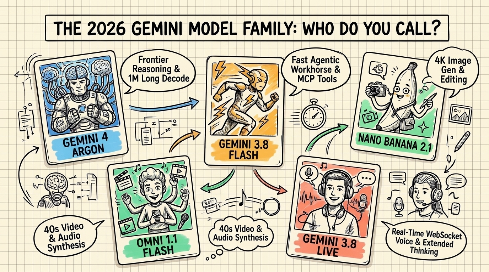
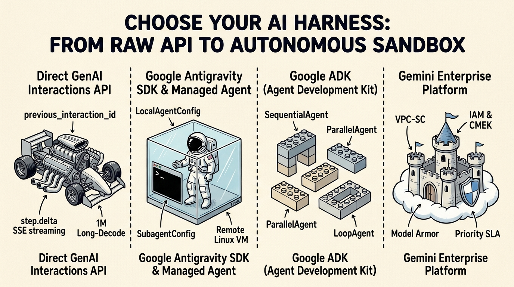
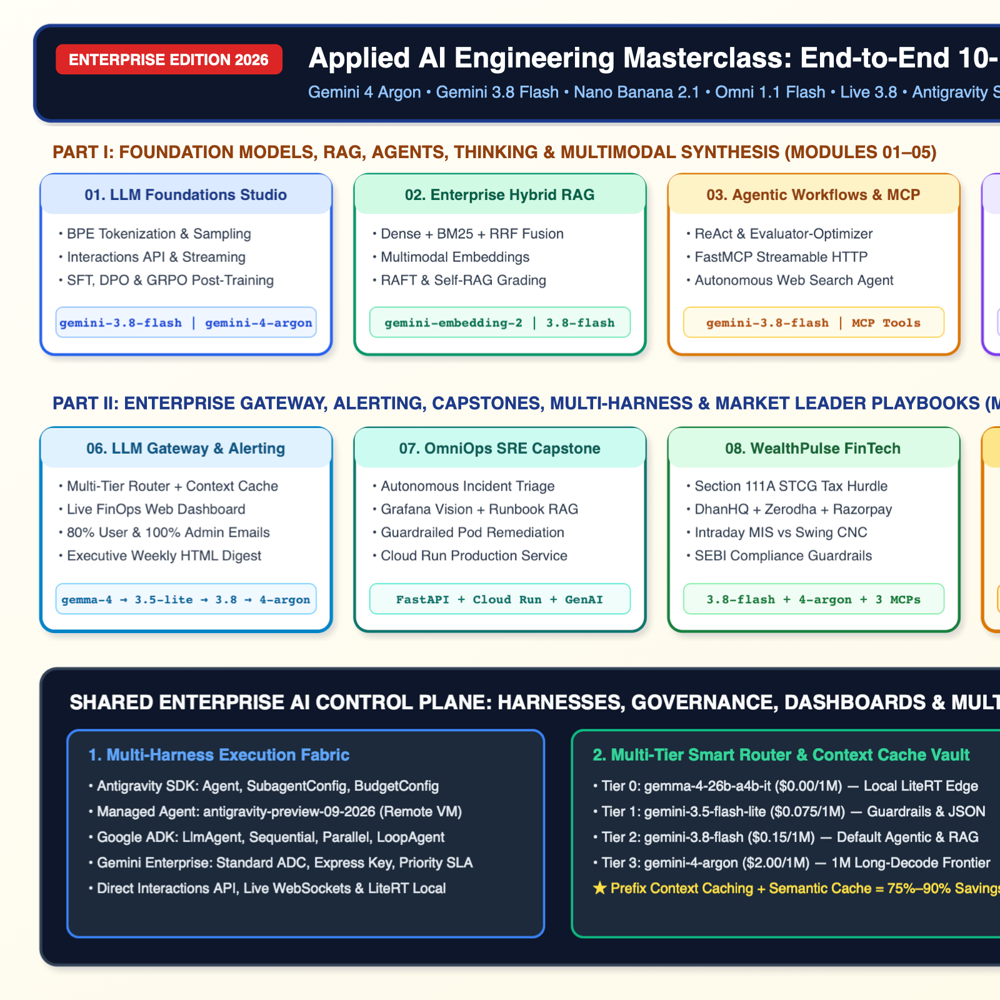
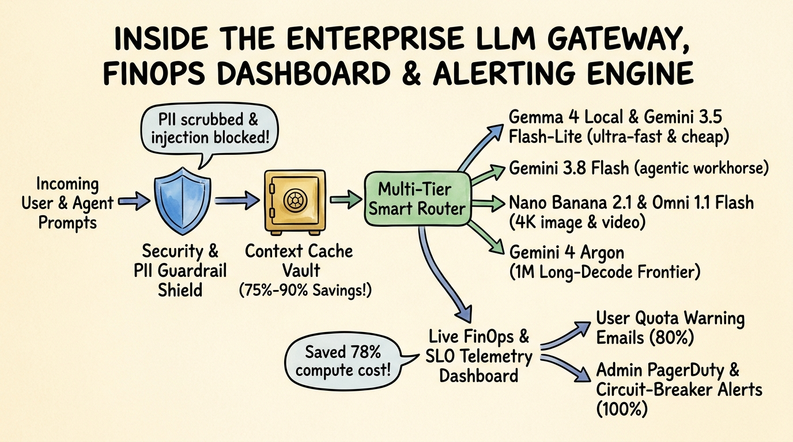
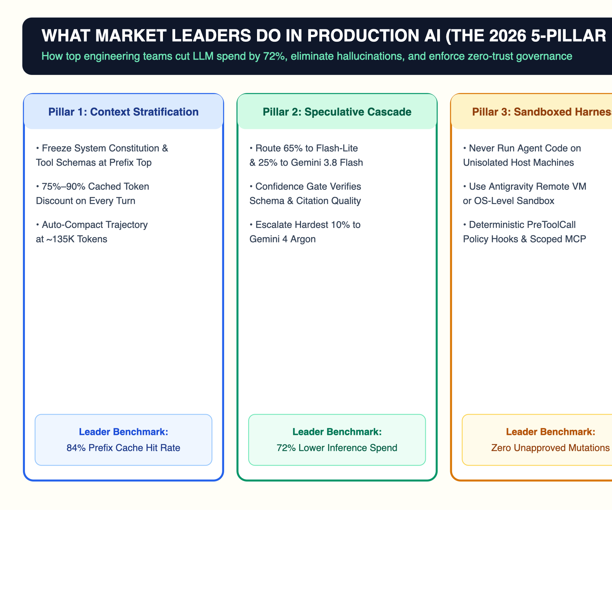

# 🚀 Applied AI Engineering Masterclass & Interactive Workshop (2026 Edition)
### End-to-End Enterprise AI Systems with Google Gemini 4 Argon, Gemini 3.8 Flash, Multimodals, Multi-Harness Orchestration, LLM Gateway, FinOps Dashboards & Automated Alerting

[](https://github.com/googleapis/python-genai)
[](https://ai.google.dev)
[](https://ai.google.dev)
[](https://cloud.google.com/run)
[](LICENSE)

> **Welcome to the 2026 Visual & Interactive Applied AI Engineering Curriculum!** 👋  
> Because your brain learns best through **visual metaphors, Fireside Chats, architectural sketchnotes, and runnable production microservices**, we have engineered this repository as an interactive, end-to-end masterclass. It covers the complete **2026 Google Gemini & Gemma Model Portfolio** (`gemini-4-argon`, `gemini-3.8-flash`, `gemini-3.5-flash-lite`, `gemini-nano-banana-2.1`, `gemini-omni-1.1-flash`, `gemini-3.8-live-extended-thinking`, `gemini-3.8-flash-tts`, `gemini-embedding-2`, `gemma-4-26b-a4b-it`) across **all 6 execution harnesses**, backed by a live **Multi-Tier Enterprise LLM Gateway, Executive FinOps Dashboard, and Multi-Channel User/Admin HTML Email Alerting Engine**.

---

## 🎨 Visual Architecture Guide: The 2026 Gemini Model Family

<p align="center">
  
</p>

| Tier / Modality | Official 2026 Model ID | Context / Output Window | Primary Enterprise Use Case |
| :--- | :--- | :--- | :--- |
| **Tier 3: Frontier Reasoning, Judge & Long-Decode** | `gemini-4-argon` | **1,048,576 unified** (up to **1M output** via `background=True` hops) | Hardest software architecture, financial/tax optimization, formal proofs, LLM-as-a-Judge, Antigravity deep mode (`thinking_level="low"\|"medium"\|"high"`). |
| **Tier 2: Default Agentic & Multimodal Workhorse** | `gemini-3.8-flash` | 1,048,576 / 65,536 | Default model for Antigravity SDK & Managed Agents, ReAct MCP tool calling, Hybrid RAG synthesis, visual chart triage. |
| **Tier 1: High-Throughput Cost-Optimized Lite** | `gemini-3.5-flash-lite` | 1,048,576 / 65,536 | Pre-inference prompt-injection guardrails, PII scrubbing, fast intent routing, high-volume JSON extraction. |
| **Tier 0: On-Device Local Open-Weights (LiteRT)** | `gemma-4-26b-a4b-it` / `gemma-4-31b-it` | Local Loopback (`LiteRTAgentConfig`) | Air-gapped / offline local coding & operations agents (26B total / 4B active MoE parameters, $0 API cost). |
| **Multimodal Image Gen & Editing (Nano Banana)** | `gemini-nano-banana-2.1` | 131K / 32K (1K, 2K, 4K) | Studio 4K image generation, conversational visual editing, up to **14 reference images** fusion, SynthID watermarking. |
| **Generative Video & Audio Synthesis** | `gemini-omni-1.1-flash` | 131K (360p, 720p, 1080p, 4K) | Text-to-video, `<FIRST_FRAME>` / `<LAST_FRAME>` transitions, `<IMAGE_REF_0>` / `<VIDEO_REF_0>`, and **40s video extensions**. |
| **Real-Time WebSocket Voice & Video (Live API)** | `gemini-3.8-live` / `gemini-3.8-live-extended-thinking` | 128K / 64K (PCM 16kHz in / 24kHz out) | Sub-second bidirectional voice/video agents, `behavior="NON_BLOCKING"` async tools with spoken fillers, `interaction_status` tracking. |
| **Speech-to-Text (STT) & Text-to-Speech (TTS)** | `gemini-3.8-flash-tts` / `gemini-3.5-transcribe-live` | 65K | Multi-speaker dialogue, `speech_metadata` annotations, Voice Design personas, smart vs verbatim real-time STT with Hybrid VAD. |
| **Multimodal Semantic Embeddings** | `gemini-embedding-2` | Multimodal Vector Space | Unified dense embeddings across text, images, video, audio, and PDFs for Hybrid RRF search & semantic caching. |

---

## 🏎️ Choose Your AI Harness: From Raw API to Autonomous Cloud Sandbox

<p align="center">
  
</p>

| Harness | SDK / Entrypoint | Sandbox & Governance | When Market Leaders Pick This Harness |
| :--- | :--- | :--- | :--- |
| **1. Direct GenAI Interactions API** | `from google import genai` → `client.interactions.create()` | Server-stored 55-day state (`previous_interaction_id`) | Custom microservices, `gemini-4-argon` 1M Long-Decode (`background=True`), fine-grained `step.delta` SSE streaming. |
| **2. Google Antigravity SDK** | `from google.antigravity import Agent, LocalAgentConfig, LiteRTAgentConfig` | OS-level sandbox (`RunCommandConfig(enable_sandbox=True)`), `@hooks.pre_tool_call` | Autonomous & interactive (`ASK_QUESTION`) coding/ops agents, hierarchical `SubagentConfig` (`max_subagent_depth=3`), `BudgetConfig`, `CompactionConfig`. |
| **3. Gemini Managed Agents** | `client.interactions.create(agent="antigravity-preview-09-2026", environment="remote")` | Ephemeral Google-hosted Linux container VM + Git repo mounting | Zero-infra remote Bash/Python execution, `agent_config={"type": "antigravity", "model": "gemini-4-argon"}`, and `deep-research-max-preview-04-2026`. |
| **4. Google ADK (Agent Development Kit)** | `google.adk` (`LlmAgent`, `SequentialAgent`, `ParallelAgent`, `LoopAgent`) | Deterministic DAG control flow + `SessionService` | Multi-agent fan-out/fan-in workflows, strict sequential compliance pipelines, Vertex AI Agent Engine deployments. |
| **5. Gemini Enterprise Platform** | `LocalAgentConfig(vertex=True, project=..., location=...)` or Express API Key | VPC Service Controls (VPC-SC), CMEK, IAM, Model Armor | Regulated banking, healthcare, government, **Priority Inference (`ServiceTier.PRIORITY`)**, and **Flex Inference**. |
| **6. Raw REST, FastMCP & Live WebSockets** | `POST /v1beta/interactions`, `client.aio.live.connect()`, `FastMCP` | Ephemeral client tokens, Streamable HTTP MCP | Polyglot gateways, browser/mobile WebRTC/WebSocket voice agents, reusable enterprise MCP tool servers. |

---

## 🏛️ Master 10-Module Curriculum & System Architecture

<p align="center">
  
</p>

---

## 📁 Complete 10-Module Workshop Index & Interactive Notebooks

| Module | Interactive Notebook & Microservice | Core Capabilities Mastered |
| :--- | :--- | :--- |
| **01. Core Foundations** | [`01_LLM_Foundations_Interactive_Playground.ipynb`](./01_LLM_Foundations_Interactive_Playground/01_LLM_Foundations_Interactive_Playground.ipynb) | BPE tokenization, Temperature/Top-p sampling physics, Post-training (SFT, DPO, GRPO), **Stateful Interactions API**, and **`gemini-4-argon` vs `gemini-3.8-flash` studio**. |
| **02. Enterprise Hybrid RAG** | [`02_Enterprise_RAG_Knowledge_Assistant.ipynb`](./02_Enterprise_RAG_Knowledge_Assistant/02_Enterprise_RAG_Knowledge_Assistant.ipynb) | Multimodal embeddings (`gemini-embedding-2`), semantic chunking, Dense + BM25 Reciprocal Rank Fusion (RRF), RAFT defense, and **Stratified Prefix Context Caching**. |
| **03. Agentic Workflows & MCP** | [`03_Agentic_Workflows_Web_Search_Agent.ipynb`](./03_Agentic_Workflows_Web_Search_Agent/03_Agentic_Workflows_Web_Search_Agent.ipynb) | ReAct loops, Evaluator-Optimizer reflection, Streamable HTTP Model Context Protocol (MCP), and **Managed Antigravity Agent (`antigravity-preview-09-2026`)** integration. |
| **04. Cognitive Reasoning & Long-Decode** | [`04_Reasoning_Models_Deep_Research_Engine.ipynb`](./04_Reasoning_Models_Deep_Research_Engine/04_Reasoning_Models_Deep_Research_Engine.ipynb) | System 1 vs System 2 thinking, **`gemini-4-argon` 1M Unified Window & Long-Decode continuation hops (`background=True`)**, `thinking_level` tuning, and **`deep-research-max-preview-04-2026`**. |
| **05. Multimodal & Live Studio** | [`05_Multimodal_Vision_Media_Synthesis_Agent.ipynb`](./05_Multimodal_Vision_Media_Synthesis_Agent/05_Multimodal_Vision_Media_Synthesis_Agent.ipynb) | **Nano Banana 2.1 (`gemini-nano-banana-2.1`)** 4K editing & 14-reference image fusion, **Gemini Omni 1.1 Flash (`gemini-omni-1.1-flash`)** 40s video extensions, **Gemini 3.8 Live Extended Thinking**, and **3.8 Flash TTS**. |
| **06. LLM Gateway, Dashboards & Alerting** | [`06_Tokenomics_Cost_Optimization_LLM_Gateway.ipynb`](./06_Tokenomics_Cost_Optimization_LLM_Gateway/06_Tokenomics_Cost_Optimization_LLM_Gateway.ipynb) + [**Live FastAPI Web App (`app/main.py`)**](./06_Tokenomics_Cost_Optimization_LLM_Gateway/app/main.py) | **Multi-Tier + Multimodal Smart Router**, Prefix & Semantic Context Caching (75–90% savings), **Live FinOps Web Dashboard**, and **Automated User (80% Quota) & Admin (100% Circuit-Breaker / SecOps / Executive Digest) HTML Email Alerting**. |
| **07. Capstone: OmniOps SRE** | [`07_Capstone_OmniOps_Autonomous_SRE_Platform.ipynb`](./07_Capstone_OmniOps_Autonomous_SRE_Platform/07_Capstone_OmniOps_Autonomous_SRE_Platform.ipynb) + [**FastAPI Service (`app/main.py`)**](./07_Capstone_OmniOps_Autonomous_SRE_Platform/app/main.py) | Autonomous incident triage uniting Hybrid Runbook RAG (`gemini-embedding-2`) + Grafana Vision + Dual-Model escalation (`gemini-3.8-flash` → `gemini-4-argon`) on **Google Cloud Run**. |
| **08. Capstone: WealthPulse FinTech** | [`08_Tax_Aware_Target_Return_Fintech_Platform.ipynb`](./08_Tax_Aware_Target_Return_Fintech_Platform/08_Tax_Aware_Target_Return_Fintech_Platform.ipynb) + [**FastAPI Service (`app/main.py`)**](./08_Tax_Aware_Target_Return_Fintech_Platform/app/main.py) | Tax-aware wealth copilot with **DhanHQ + Zerodha Kite + Razorpay MCP servers**, Indian Section 111A STCG (20.8%) tax hurdle calculator, intraday MIS vs swing CNC engine, and SEBI guardrails. |
| **09. Multi-Harness Engineering Lab ★ NEW** | [`09_Multi_Harness_Agentic_Engineering_Lab.ipynb`](./09_Multi_Harness_Agentic_Engineering_Lab/09_Multi_Harness_Agentic_Engineering_Lab.ipynb) + [`harness_orchestrator.py`](./09_Multi_Harness_Agentic_Engineering_Lab/harness_orchestrator.py) | Hands-on side-by-side mastery of **Antigravity SDK (`LocalAgentConfig`, `SubagentConfig`, `BudgetConfig`, `CompactionConfig`, `LiteRTAgentConfig`)**, **Managed Agents**, **Google ADK**, **Gemini Enterprise**, and **Direct Interactions API**. |
| **10. Market Leaders Playbook ★ NEW** | [`10_Industry_Best_Practices_Market_Leaders_Playbook.ipynb`](./10_Industry_Best_Practices_Market_Leaders_Playbook/10_Industry_Best_Practices_Market_Leaders_Playbook.ipynb) + [`market_leaders_playbook.py`](./10_Industry_Best_Practices_Market_Leaders_Playbook/market_leaders_playbook.py) | **The 2026 5-Pillar Production AI Playbook**: Stratified Context Compaction, Speculative Cascade Routing, Sandboxed Pre/Post Hooks, **LLM-as-a-Judge (`gemini-4-argon`) CI/CD Release Gates**, and Executive FinOps Reporting. |

---

## 🚨 Inside Module 06: Enterprise LLM Gateway, FinOps Dashboard & User/Admin Email Alerting

<p align="center">
  
</p>

Launch the interactive **OmniGateway FinOps & Alerting Command Center** locally in seconds:
```bash
cd 06_Tokenomics_Cost_Optimization_LLM_Gateway/app
uvicorn main:app --host 0.0.0.0 --port 8086
# Open http://localhost:8086 in your browser!
```

### Built-In Multi-Channel Email & Webhook Alerting Scenarios (`06_Tokenomics_Cost_Optimization_LLM_Gateway/app/alerting.py`):
1. **⚠️ User 80% Quota Warning Email (`USER_QUOTA_WARNING_80`)**: Dispatched automatically to the workspace developer/team lead when spend hits 80% of their cap, displaying their `thoughts_token_count` share and actionable instructions on lowering `thinking_level` or enabling Prefix Context Caching.
2. **✅ User Long-Decode / Deep Research Completion Email (`USER_BACKGROUND_JOB_COMPLETE`)**: Dispatched when an asynchronous `gemini-4-argon` (`background=True`) or `deep-research-max-preview-04-2026` job finishes across continuation hops.
3. **🚨 Admin 100% Circuit-Breaker Trip Email & PagerDuty Alert (`ADMIN_CIRCUIT_BREAKER_TRIP_100`)**: Dispatched to Platform Admins & FinOps when a tenant hits 100% hard cap, automatically downgrading non-critical requests to `gemini-3.5-flash-lite`.
4. **🛡️ SecOps Guardrail Interception Alert (`ADMIN_SECURITY_GUARDRAIL_BLOCK`)**: Dispatched immediately when pre-inference guardrails block prompt injection or redact leaked secrets/PII.
5. **📈 Executive Weekly FinOps & Governance HTML Digest (`EXECUTIVE_WEEKLY_FINOPS_REPORT`)**: Executive summary with KPI cards (Total Requests, Net $ Saved vs Always-Argon Baseline, Context Cache Hit Rate, and 4-Tier Traffic Share).

---

## 🏆 What Market Leaders Are Doing in Production AI (Module 10 Summary)

<p align="center">
  
</p>

---

## ⚡ Quickstart: Run All Labs & Microservices in 3 Minutes

```bash
# 1. Clone & install dependencies
git clone https://github.com/cmanikandan/ai-engineering.git
cd ai-engineering
python3 -m venv .venv && source .venv/bin/activate
pip install -r requirements.txt

# 2. Configure your Gemini API Key (or Vertex AI ADC)
export GEMINI_API_KEY="your-gemini-api-key"

# 3. Launch the Interactive LLM Gateway & Alerting Dashboard (Port 8086)
python3 06_Tokenomics_Cost_Optimization_LLM_Gateway/app/main.py

# 4. Run the Multi-Harness Orchestrator & Market Leaders Playbook Suites
python3 09_Multi_Harness_Agentic_Engineering_Lab/harness_orchestrator.py
python3 10_Industry_Best_Practices_Market_Leaders_Playbook/market_leaders_playbook.py
```

---

## 📄 License
Licensed under the [Apache License 2.0](LICENSE). Crafted for Applied AI Engineers, Cloud Architects, and Technical Leaders. 🚀
